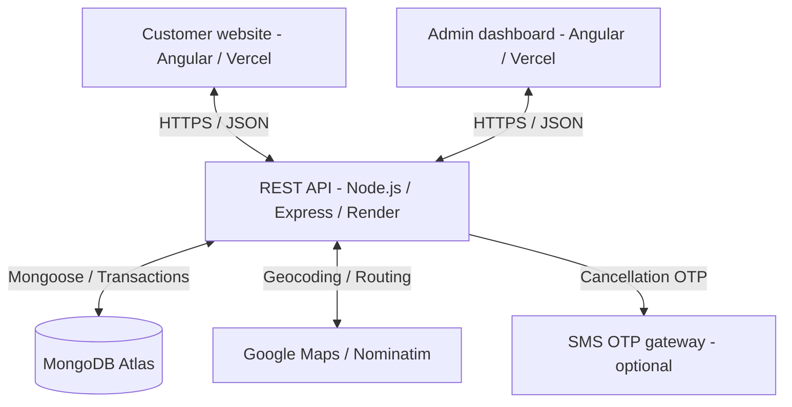
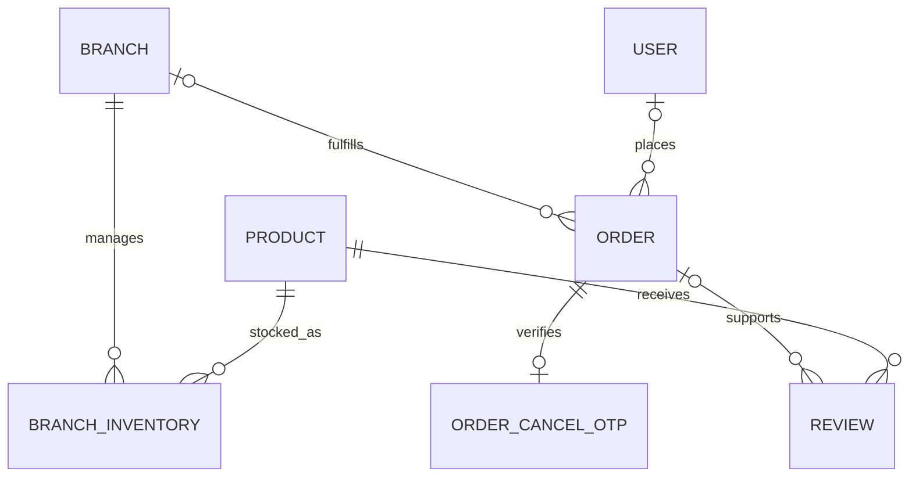

# 🍩 LỊM DONUTS — Full-stack E-commerce Website


Website thương mại điện tử dành cho thương hiệu bánh donut Lịm Donuts, hỗ trợ mua sắm trực tuyến, đặt bánh tùy chỉnh, quản lý đơn hàng và vận hành cửa hàng trên nhiều chi nhánh.

## 🌐 Live Demo

| Thành phần | Địa chỉ |
| --- | --- |
| Website khách hàng | [limdonut.vercel.app](https://limdonut.vercel.app) |
| Website quản trị | [limdonutadmin.vercel.app](https://limdonutadmin.vercel.app/) |
| Backend REST API | [limdonut-backend-ew0p.onrender.com](https://limdonut-backend-ew0p.onrender.com/api/products) |

## ✨ Chức năng chính

### Website khách hàng

- Xem menu, tìm kiếm/lọc sản phẩm, xem thông tin chi tiết, topping và dinh dưỡng.
- Quản lý giỏ hàng, đặt hàng giao tận nơi hoặc nhận tại cửa hàng.
- Chọn chi nhánh và kiểm tra tồn kho phù hợp khi checkout.
- Custom Party: tùy chỉnh set bánh và xem trước 3D.
- Flash Sale, voucher, Lịm Stars, ưu đãi giới thiệu và chế độ quà tặng.
- Checkout, đặt cọc và các luồng thanh toán mô phỏng.
- Đăng ký, đăng nhập, quản lý hồ sơ, yêu thích và lịch sử đơn hàng.
- Tra cứu đơn hàng bằng tên và số điện thoại dành cho khách vãng lai.
- Theo dõi trạng thái, chỉnh sửa và hủy đơn theo điều kiện nghiệp vụ.
- Đánh giá sản phẩm thuộc đơn đã hoàn thành, gửi khiếu nại và liên hệ cửa hàng.
- Xem bài viết/diễn đàn, thông tin chi nhánh và bản đồ.

### Website quản trị (Admin)

- Đăng nhập quản trị và kiểm soát quyền truy cập.
- Dashboard thống kê doanh thu, đơn hàng, sản phẩm bán chạy và tồn kho.
- Quản lý đơn hàng theo trạng thái trên Kanban Board.
- Quản lý sản phẩm, danh mục, Flash Sale và tồn kho theo chi nhánh.
- Quản lý khách hàng, voucher, chi nhánh và bài viết.
- Xử lý khiếu nại và tin nhắn liên hệ.

### Nghiệp vụ nổi bật trong Web 2

| Nghiệp vụ | Cách xử lý |
| --- | --- |
| Tồn kho theo chi nhánh | `BranchInventory` lưu số lượng theo cặp `branchId` và `productId`; chỉ mục duy nhất ngăn bản ghi tồn kho trùng. |
| Đặt hàng | Dùng cập nhật tồn kho có điều kiện và MongoDB Transaction cho các thao tác liên quan đến đơn hàng thông thường, voucher và Lịm Stars. Combo sử dụng kho của các bánh thành phần. |
| Chỉnh sửa đơn | Xem trước và xác nhận thay đổi sản phẩm, số lượng hoặc thời gian nhận; kiểm tra lại điều kiện nghiệp vụ và chênh lệch giá. |
| Thay đổi thông tin giao nhận | Cho phép đổi địa chỉ hoặc chuyển sang nhận tại cửa hàng khi đủ điều kiện; kiểm tra chi nhánh, tồn kho, phạm vi giao và phí mới. |
| Giữ chân khách | Gợi ý sửa đơn, đổi giờ nhận, nhận tại cửa hàng hoặc đổi địa chỉ thay vì hủy đơn; khách vẫn có thể tiếp tục hủy. |
| Hủy đơn | Ghi nhận 7 nhóm lý do, ghi chú và thời gian; xử lý hoàn tồn kho, lượt voucher, Stars và ghi nhận tiền cọc theo điều kiện. |
| OTP hủy đơn | Xác thực khách vãng lai bằng OTP; mã được lưu dưới dạng digest, có thời hạn, giới hạn gửi lại và số lần xác minh. Gửi SMS thật cần cấu hình gateway. |
| Đánh giá | Kiểm tra đơn đã hoàn thành, sản phẩm đã mua, quyền đánh giá của thành viên hoặc khách vãng lai; kiểm soát đánh giá trùng. |

**Bản đồ và khoảng cách:** `backend/utils/maps.js` hỗ trợ Google Geocoding API và Google Routes API khi có `GOOGLE_MAPS_API_KEY`. Luồng đổi địa chỉ có thể sử dụng khoảng cách đường lái xe của Google để tính lại phí. Khi không cấu hình key, hệ thống sử dụng Nominatim để định vị và ước tính khoảng cách đường chim bay (Haversine). Checkout hiện tính khoảng cách Haversine từ tọa độ đã định vị. Luồng thay đổi phương thức giao nhận giới hạn khoảng cách giao tối đa 15 km.

## 🛠️ Tech Stack

| Tầng | Công nghệ |
| --- | --- |
| Customer frontend | Angular 21.2, TypeScript 5.9, RxJS 7.8, Bootstrap 5.3 |
| Custom Party 3D | Three.js, Google model-viewer |
| Admin frontend | Angular 21.2, TypeScript 5.9, RxJS |
| Backend | Node.js, Express 5.2, CommonJS |
| Database | MongoDB Atlas, Mongoose 9.6 |
| Authentication | JWT, bcryptjs |
| Middleware | CORS, Helmet, Morgan, express-rate-limit, Multer |
| Maps & location | Google Geocoding API, Routes API, OpenStreetMap Nominatim, HTML5 Geolocation |
| Testing | Jest, Supertest (backend); Vitest, jsdom (frontend) |
| Deployment | Vercel, Render, MongoDB Atlas |

## 🏗️ System Architecture



Hai ứng dụng Angular được triển khai riêng, sử dụng chung backend REST API và cơ sở dữ liệu. Backend xử lý xác thực, phân quyền, các quy tắc nghiệp vụ và truy vấn dữ liệu. MongoDB không được kết nối trực tiếp từ frontend.

## 📁 Project Structure

```text
LIM-Donut/
├── backend/
│   ├── middleware/       # Xác thực, phân quyền, rate limiting
│   ├── models/           # Mongoose schemas
│   ├── routes/           # REST API và xử lý nghiệp vụ
│   ├── utils/            # Pricing, inventory, OTP, maps, order editing
│   ├── scripts/          # Seed dữ liệu và hỗ trợ chuyển đổi tồn kho
│   ├── tests/            # Kiểm thử backend
│   ├── uploads/          # File upload tại máy chủ
│   ├── package.json
│   └── server.js
├── my-app/               # Website khách hàng (Angular)
│   ├── public/
│   ├── src/app/
│   ├── src/environments/
│   ├── angular.json
│   └── package.json
├── my-app-admin/         # Website quản trị (Angular)
│   ├── public/
│   ├── src/app/
│   ├── src/environments/
│   ├── angular.json
│   └── package.json
├── DEPLOY.md
├── .gitignore
└── README.md
```

## 🗄️ Database Design

Các collection tương ứng với các Mongoose models hiện có trong `backend/models/` (tên collection theo quy tắc đặt tên mặc định của Mongoose):

| Collection | Nội dung |
| --- | --- |
| `users` | Người dùng, tài khoản và dữ liệu thành viên |
| `products` | Thông tin sản phẩm |
| `categories` | Danh mục sản phẩm |
| `branches` | Thông tin chi nhánh |
| `branchinventories` | Tồn kho sản phẩm theo chi nhánh |
| `orders` | Đơn hàng, trạng thái, lịch sử chỉnh sửa và hủy đơn |
| `ordercancelotps` | OTP hủy đơn, thời hạn và số lần xác minh |
| `vouchers` | Mã giảm giá và điều kiện sử dụng |
| `reviews` | Đánh giá sản phẩm |
| `blogposts` | Bài viết/diễn đàn |
| `complaints` | Khiếu nại khách hàng |
| `contactmessages` | Tin nhắn liên hệ |



Sơ đồ trên là mô hình dữ liệu khái quát. `BranchInventory.productId` tham chiếu `Product.id` kiểu Number; `branchId` liên kết với `Branch._id` kiểu ObjectId. Đơn khách vãng lai có thể không có `userId`, và một số đơn cũ có thể chưa có `branchId`. OTP có chỉ mục TTL để hỗ trợ dọn bản ghi hết hạn.

## 🔌 Selected API Endpoints

Base URL local: `http://localhost:3000`.

| Method | Endpoint | Mô tả |
| --- | --- | --- |
| POST | `/api/auth/register` | Đăng ký |
| POST | `/api/auth/login` | Đăng nhập |
| GET / PATCH | `/api/auth/me` | Xem / cập nhật hồ sơ |
| GET | `/api/products` | Danh sách sản phẩm |
| GET | `/api/products/:id` | Chi tiết sản phẩm |
| GET | `/api/branches` | Danh sách chi nhánh |
| GET | `/api/inventory/:branchId` | Tồn kho chi nhánh |
| PUT | `/api/inventory/:branchId/:productId` | Cập nhật tồn kho (Admin) |
| POST | `/api/delivery-location` | Định vị địa chỉ |
| POST | `/api/vouchers/validate` | Kiểm tra voucher |
| POST | `/api/orders` | Tạo đơn hàng |
| GET | `/api/orders` | Truy vấn đơn theo quyền và tham số |
| GET | `/api/orders/lookup` | Tra cứu đơn khách vãng lai |
| POST | `/api/orders/:id/edit/quote` | Xem trước chỉnh sửa đơn |
| POST | `/api/orders/:id/edit/confirm` | Xác nhận chỉnh sửa đơn |
| POST | `/api/orders/:id/delivery-change/quote` | Xem trước thay đổi giao nhận |
| POST | `/api/orders/:id/delivery-change/confirm` | Xác nhận thay đổi giao nhận |
| POST | `/api/orders/:id/cancel-otp` | Yêu cầu OTP hủy đơn |
| PATCH | `/api/orders/:id/cancel` | Hủy đơn hàng |
| PATCH | `/api/orders/:id/status` | Cập nhật trạng thái (Admin) |
| GET | `/api/orders/stats` | Thống kê Dashboard (Admin) |
| POST | `/api/reviews` | Gửi đánh giá |
| GET | `/api/reviews/:productId/summary` | Tổng hợp đánh giá |
| POST | `/api/contact` | Gửi liên hệ |
| POST | `/api/complaints` | Gửi khiếu nại |

`:id` trong API sản phẩm là ID số; `:id` trong các API thao tác trên đơn là MongoDB `_id`. Chi tiết request, response và quy tắc phân quyền nằm trong [`backend/routes/`](./backend/routes/).

## 🚀 Getting Started

### 1. Yêu cầu môi trường

- Node.js 22 LTS (từ 22.12 trở lên được khuyến nghị cho cả ba ứng dụng; Angular và Mongoose hiện không phù hợp với hướng dẫn Node.js 18 cũ).
- npm và Git.
- MongoDB Atlas hoặc MongoDB replica set có hỗ trợ transaction. Không nên sử dụng standalone MongoDB cho các luồng có transaction.

### 2. Clone repository

```bash
git clone https://github.com/ziredrs/LIM-Donut.git
cd LIM-Donut
```

### 3. Cấu hình backend

Tạo file `backend/.env` (không commit file này lên GitHub):

```dotenv
MONGODB_URI=mongodb+srv://<username>:<password>@<cluster>/limdonut
JWT_SECRET=<replace-with-a-long-random-secret>
PORT=3000
CORS_ORIGINS=http://localhost:4200,http://localhost:4201
ADMIN_PASSWORD=<replace-with-a-strong-password>

# Optional: Google Maps (Geocoding API + Routes API)
GOOGLE_MAPS_API_KEY=

# Optional: SMS gateway for guest order cancellation
SMS_OTP_URL=
SMS_OTP_TOKEN=

# Local development only; never enable in production
CANCEL_OTP_DEMO=false
```

| Biến | Mục đích |
| --- | --- |
| `MONGODB_URI` | URI kết nối database |
| `JWT_SECRET` | Ký JWT và tạo digest OTP |
| `PORT` | Cổng backend, mặc định 3000 |
| `CORS_ORIGINS` | Danh sách frontend origins, cách nhau bằng dấu phẩy |
| `ADMIN_PASSWORD` | Mật khẩu dùng khi seed tài khoản Admin |
| `GOOGLE_MAPS_API_KEY` | Geocoding và Routes API phía server, nếu sử dụng |
| `SMS_OTP_URL`, `SMS_OTP_TOKEN` | Địa chỉ và token SMS gateway với contract trong `utils/cancel-otp.js` |
| `CANCEL_OTP_DEMO` | Cho phép OTP demo trong môi trường local đủ điều kiện |

### 4. Cài dependencies và chuẩn bị dữ liệu

Từ thư mục gốc:

```bash
cd backend
npm ci
```

Nếu dùng database phát triển mới, có thể chạy các script seed phù hợp:

```bash
node scripts/seedAdmin.js
node scripts/seedCategories.js
node scripts/seedProducts.js
node scripts/seedVouchers.js
node scripts/seedBlogPosts.js
```

Chỉ chạy seed trên database thử nghiệm hoặc database đã được sao lưu và kiểm tra. Tạo các chi nhánh và nhập tồn kho thực tế qua Admin trước khi thử đặt đơn. `seedProducts.js` không thay thế bước thiết lập tồn kho theo chi nhánh. Script `applyStockSplit.js` dành cho chuyển đổi dữ liệu có snapshot được kiểm duyệt, không phải seed mặc định và không nên chạy lại trên database đã chia kho.

### 5. Khởi chạy backend

```bash
npm run dev
```

Backend mặc định tại `http://localhost:3000`. Có thể dùng `npm start` thay cho chế độ phát triển.

### 6. Khởi chạy website khách hàng

Mở terminal mới tại thư mục gốc:

```bash
cd my-app
npm ci
npm start
```

Truy cập `http://localhost:4200`.

### 7. Khởi chạy website quản trị

Mở terminal mới tại thư mục gốc:

```bash
cd my-app-admin
npm ci
npm start
```

Truy cập `http://localhost:4201` (cổng đã được cấu hình trong `angular.json`).

Hai frontend sử dụng `environment.development.ts` khi chạy local và `environment.ts` khi build production. Kiểm tra `apiBase` nếu thay đổi URL backend.

## 🧪 Testing

Backend có bộ test Jest/Supertest bao gồm các nhóm: pricing, tồn kho theo chi nhánh, cập nhật trạng thái đơn, OTP hủy đơn, thay đổi địa chỉ, chỉnh sửa đơn, maps và đánh giá đơn hàng.

```bash
cd backend
npm test
```

Hai ứng dụng Angular có script test sử dụng `ng test` (Vitest/jsdom). Chạy riêng trong từng thư mục:

```bash
# In my-app/ or my-app-admin/
npm test
```

Để build từng frontend, chạy `npm run build` trong thư mục tương ứng. Các lệnh trên mô tả cách kiểm thử/build, không phải chứng nhận kết quả test đã pass.

## ☁️ Deployment

| Thành phần | Nền tảng | Root directory |
| --- | --- | --- |
| Customer frontend | Vercel | `my-app` |
| Admin frontend | Vercel | `my-app-admin` |
| Backend API | Render | `backend` |
| Database | MongoDB Atlas | — |

- Render: build `npm ci`, start `npm start`; thiết lập biến môi trường trên dashboard.
- Vercel: tạo hai project từ cùng repository, chọn root directory tương ứng.
- CORS production cần chứa đúng hai frontend origins, không có dấu `/` cuối.
- Chỉ cấu hình API key, JWT secret và database credentials ở backend. Giới hạn quyền truy cập DB và không commit thông tin bí mật.
- Xem thêm [DEPLOY.md](./DEPLOY.md) về quá trình triển khai; ưu tiên cấu hình URL và biến môi trường mới trong README này nếu hướng dẫn cũ chưa được cập nhật.

## 📌 Scope & Limitations

- Dự án phục vụ học tập; các luồng thanh toán trực tuyến là mô phỏng, không phải tích hợp cổng thanh toán thật. Ghi nhận xử lý tiền cọc/hoàn trả trong dữ liệu không đồng nghĩa với chuyển hoàn tiền thực tế.
- OTP quên mật khẩu hiện là luồng demo, không phù hợp production: cần gửi mã qua kênh riêng và không trả mã OTP trong response. OTP hủy đơn là luồng riêng, gửi SMS thật phụ thuộc gateway.
- Google Maps chỉ hoạt động ở chế độ Google khi có key, API và billing hợp lệ. Khoảng cách Haversine chỉ là ước tính, không phải quãng đường giao thực tế.
- Luồng tạo đơn Custom Party hiện không gọi cùng cơ chế trừ kho như đơn thông thường.
- Một số giá trị đơn hàng và phí giao nhận vẫn đến từ client; cần kiểm tra lại toàn bộ giá, phí và trạng thái thanh toán tại backend trước khi dùng production.
- File upload lưu tại máy chủ; với Render dùng filesystem tạm thời, file có thể mất khi restart/redeploy.
- Không xây dựng hệ thống hoặc giao diện shipper độc lập.

## 🎓 Academic Project

- Trường: Đại học Kinh tế - Luật, ĐHQG-HCM.
- Học phần: Phát triển Web Kinh doanh 1 và 2.
- Đề tài: Phân tích, thiết kế và phát triển website thương mại điện tử Lịm Donuts.
- Nhóm thực hiện Web 2: Bùi Thị Hải Châu và Bùi Thị Quế Lĩnh.

---

Developed for educational purposes.
